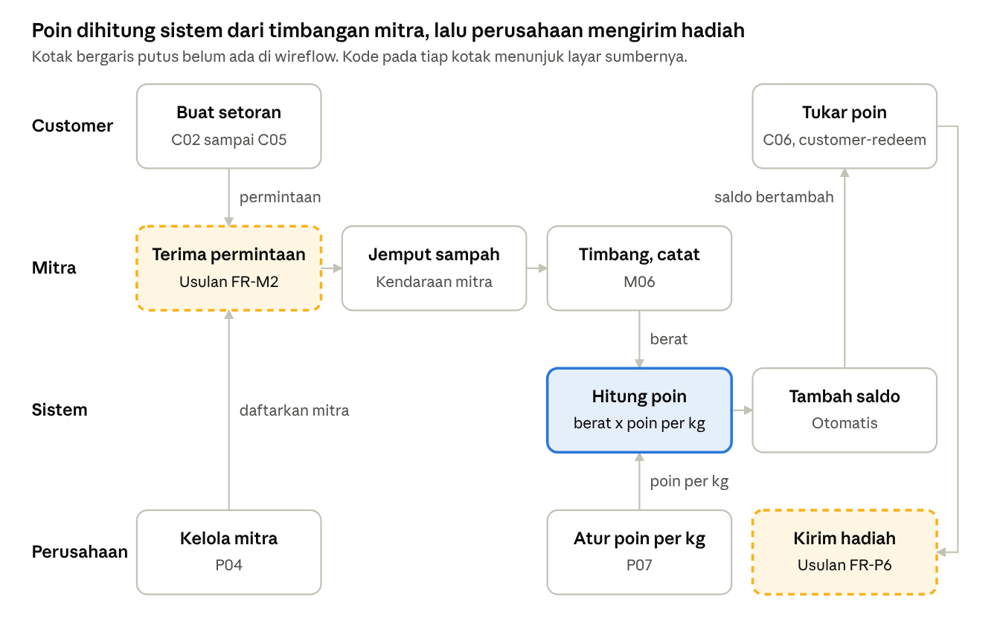
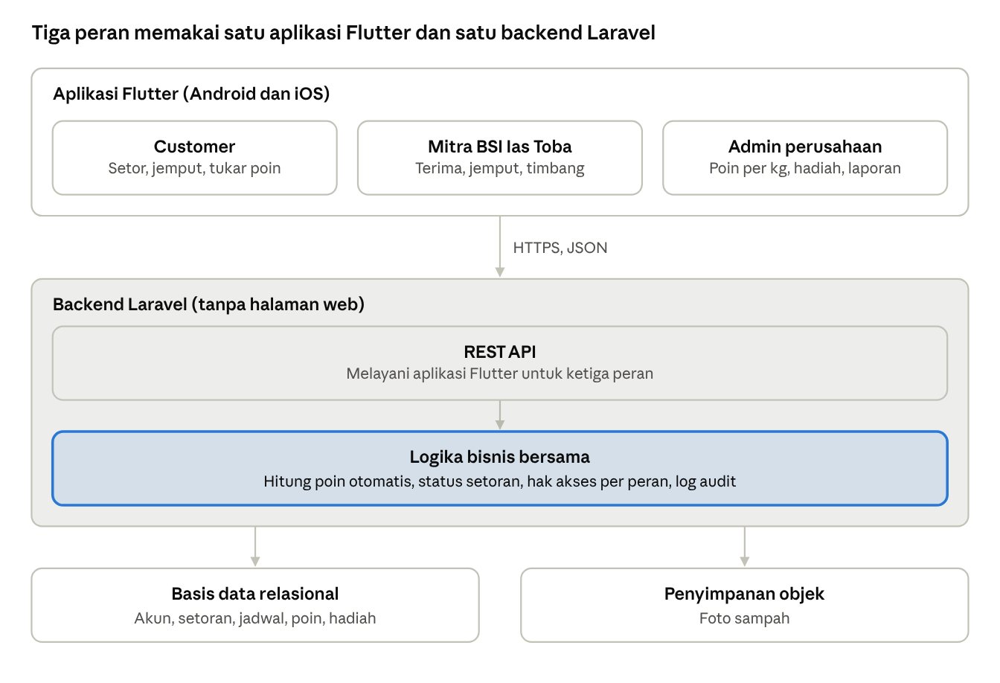

# PRD Aplikasi Pengumpulan Sampah

7 November 2026 · @josu · diperbarui 10 November 2026

> Salinan dari dokumen PRD di Claude Docs: https://claude.ai/artifact/A8Mb95nRLCsYjVeMaUxxiW.
> **Perubahan 10 November 2026:** Sirkula hanya melayani satu bank sampah, yaitu **BSI Ias Toba**, dan target finalisasi proyek maju ke **Jumat, 20 November 2026**. Salinan ini dan versi online sudah memuat perubahan tersebut.
> **Perubahan 10 November 2026 (2):** panel admin web tidak jadi dibuat. Fitur perusahaan pindah ke aplikasi Flutter sebagai peran **Admin**, dan Laravel hanya dipakai untuk backend (API).

## Ringkasan produk

Sirkula adalah aplikasi Android dan iOS dengan backend Laravel, dikelola satu perusahaan, yang menghubungkan customer dengan satu mitra bank sampah, yaitu **BSI Ias Toba**. Customer menyetor sampah terpilah ke bank sampah, mitra menimbangnya, lalu sistem otomatis memberi poin yang bisa ditukar dengan hadiah dari perusahaan. Sampah tetap dikelola bank sampah dan tidak dikirim ke perusahaan.

**Kondisi sumber.** File .zip berisi wireflow klik dari Figma Make, bukan aplikasi yang berfungsi. Isinya 24 layar inti dalam 4 jalur, semua datanya contoh, dan belum ada backend, basis data, autentikasi, atau penyimpanan.

**Cara membaca PRD ini.** Kebutuhan yang tampak di wireflow ditulis apa adanya. Hal yang tidak ada di wireflow tetapi diperlukan agar produk berjalan diberi label **Usulan** dan perlu disetujui.

**Masalah yang dijawab.** Wireflow tidak menyertakan riset, sehingga rumusan berikut adalah tafsiran dari fitur yang dirancang:

- **Customer** butuh cara mudah menyetor sampah dan alasan untuk terus memilah.
- **Mitra bank sampah** butuh cara menerima, menjemput, dan mencatat setoran customer tanpa menghitung poin sendiri.
- **Perusahaan** butuh gambaran setoran di BSI Ias Toba, serta kendali atas poin, hadiah, dan laporan.

## Tujuan dan metrik

Proyek ditargetkan final pada **Jumat, 20 November 2026**, dengan target 500 kg sampai 1 ton sampah terkumpul per bulan di BSI Ias Toba. Rilis itu harus menjalankan satu siklus penuh dengan data nyata: customer menyetor ke bank sampah, mitra menimbang, sistem memberi poin, lalu customer menukar poin dengan hadiah.

- Mengumpulkan 500 kg sampai 1 ton sampah terpilah per bulan di BSI Ias Toba.
- Membuat setiap setoran tercatat beratnya dan poinnya bisa dilacak.
- Mendorong customer terus menyetor melalui poin dan hadiah.

Target volume sudah ditetapkan. Metrik lain dipantau sejak rilis, dan targetnya bisa ditetapkan setelah bulan pertama berjalan.

| Metrik | Definisi |
| --- | --- |
| Volume sampah | Total kg setoran yang ditimbang per bulan, per bank sampah dan per jenis sampah |
| Emisi terhindarkan | Total tCO2e dari volume yang ditimbang |
| Customer aktif | Customer dengan minimal satu setoran dalam sebulan |
| Poin diberikan | Total poin yang diberikan sistem per bulan |
| Hadiah ditukar | Jumlah penukaran dan total poin yang dipakai per bulan |
| Usulan: waktu jemput | Rentang waktu dari permintaan customer sampai sampah dijemput |

## Pengguna dan peran

Sirkula punya tiga peran: customer, mitra bank sampah, dan perusahaan. Mitra menjemput dengan kendaraannya sendiri, jadi tidak ada peran pengemudi terpisah.

| Peran | Siapa | Kebutuhan utama | Yang bisa dilakukan |
| --- | --- | --- | --- |
| Customer | Warga yang memilah sampah | Menyetor dengan mudah dan mendapat imbalan | Pilih bank sampah, minta dijemput atau antar sendiri, pantau setoran, tukar poin |
| Mitra | Bank sampah yang bekerja sama dengan perusahaan | Menerima dan mencatat setoran dengan cepat | Terima atau tolak permintaan, jemput dengan kendaraan sendiri, timbang dan catat berat |
| Perusahaan | Staf pengelola Sirkula | Memantau BSI Ias Toba dan menjalankan program poin | Kelola data bank sampah, atur poin per kg, kelola dan kirim hadiah, lihat laporan |

## Ruang lingkup

Rilis pertama mencakup aplikasi Android dan iOS untuk tiga peran (customer, mitra, dan admin perusahaan) beserta backend Laravel, dengan alur customer dan mitra di wireflow, ditambah bagian yang hilang tetapi diperlukan agar siklusnya tertutup.

**Termasuk**

- Masuk, daftar, dan akses berdasarkan peran.
- Setoran customer ke bank sampah mitra, dengan dijemput atau diantar sendiri.
- Penjadwalan jemput oleh mitra, memakai kendaraan mitra.
- Penimbangan oleh mitra dan poin otomatis dari sistem.
- Katalog hadiah, penukaran poin, dan pengiriman hadiah oleh perusahaan.
- Data mitra, laporan yang bisa diunduh sebagai PDF dan Excel, serta pengaturan jenis sampah dan poin per kg.
- Notifikasi di dalam aplikasi.
- Usulan: formulir daftar dan daftar permintaan customer di sisi mitra.

**Tidak termasuk**

- Pengiriman sampah dari mitra ke perusahaan, dan pembayaran perusahaan ke mitra.
- Notifikasi lewat email dan WhatsApp.
- Usulan: pelacakan kendaraan mitra langsung di peta.
- Usulan: pembayaran rupiah di dalam aplikasi.
- Versi web untuk customer, mitra, dan admin.

## Kebutuhan fungsional

Kode seperti P03 merujuk layar pada lembar wireflow. Kode seperti `company-schedule` merujuk layar yang sudah ditulis di kode tetapi tidak tampil di lembar. Prioritas di bawah adalah usulan: Wajib untuk rilis pertama, Berikutnya untuk setelahnya.

Sampah berhenti di bank sampah mitra dan tidak dikirim ke perusahaan. Poin customer dihitung sistem dari berat timbangan mitra, sedangkan perusahaan mengatur poin per kg dan mengirim hadiah.

### Akses

| ID | Kebutuhan | Layar | Prioritas |
| --- | --- | --- | --- |
| FR-A1 | Menampilkan splash saat aplikasi dibuka | A01 | Berikutnya |
| FR-A2 | Masuk dengan email atau nomor ponsel dan kata sandi | A02 | Wajib |
| FR-A3 | Menampilkan tampilan dan hak akses sesuai peran Customer, Mitra, atau Perusahaan | A03 | Wajib |
| FR-A4 | Usulan: formulir daftar, karena wireflow hanya memiliki tautan "Daftar" | A02 | Wajib |
| FR-A5 | Usulan: pemulihan kata sandi | Belum ada | Wajib |

### Customer

| ID | Kebutuhan | Layar | Prioritas |
| --- | --- | --- | --- |
| FR-C1 | Beranda menampilkan total berat, saldo poin, jadwal aktif, grafik, aktivitas, dan status jemput | C01 | Wajib |
| FR-C2 | ~~Mencari dan memilih bank sampah mitra~~ Tidak dipakai: hanya ada satu bank sampah (BSI Ias Toba), jadi customer langsung mengisi setoran | C02 | Dihapus |
| FR-C3 | Memilih jenis sampah dan perkiraan berat, lalu melihat estimasi poin | C03 | Wajib |
| FR-C4 | Mengisi alamat, tanggal, dan slot 09.00–11.00, 13.00–15.00, 15.00–17.00, atau antar sendiri | C04 | Wajib |
| FR-C5 | Meninjau mitra, sampah, jadwal, dan estimasi poin sebelum mengonfirmasi | C05 | Wajib |
| FR-C6 | Melihat status dan riwayat setoran | C05 (isi layar belum sesuai) | Wajib |
| FR-C7 | Melihat saldo poin dan katalog Voucher, E-Wallet, Sembako, serta Bibit | C06 | Wajib |
| FR-C8 | Melihat detail hadiah, harga poin, dan sisa saldo setelah penukaran | `customer-reward-detail` | Wajib |
| FR-C9 | Mengonfirmasi penukaran dan mengisi alamat pengiriman | `customer-redeem` | Wajib |
| FR-C10 | Melihat status di riwayat penukaran | `customer-redeemed` | Wajib |
| FR-C11 | Mengelola data akun, alamat, pengaturan, dan bantuan | C07 | Berikutnya |

### Mitra

Layar M02 sampai M04 di wireflow, yaitu setoran mitra ke perusahaan, tidak dipakai lagi.

| ID | Kebutuhan | Layar | Prioritas |
| --- | --- | --- | --- |
| FR-M1 | Beranda menampilkan total berat yang diterima dibanding target bulanan, jumlah customer, jadwal jemput hari ini, dan aktivitas | M01 | Wajib |
| FR-M2 | Melihat permintaan setoran dari customer, lalu menerima atau menolaknya | Belum ada | Wajib |
| FR-M3 | Mengatur jadwal jemput dan kendaraan mitra yang dipakai | M03, diubah | Wajib |
| FR-M4 | Mencari customer lewat nomor ponsel atau ID, lalu mencatat jenis dan berat hasil timbang | M06 | Wajib |
| FR-M5 | Mencatat setoran customer yang datang langsung tanpa permintaan lebih dulu | M06 | Wajib |
| FR-M6 | Melihat poin hasil hitungan sistem sebelum menyimpan, tanpa bisa mengubah angkanya | M07 | Wajib |
| FR-M7 | Melihat riwayat setoran yang diterima dan total poin yang diberikan sistem bulan ini | M05, `partner-points` | Berikutnya |
| FR-M8 | Usulan: mengoreksi berat yang salah catat dengan alasan, dan poin ikut disesuaikan | Belum ada | Berikutnya |

### Perusahaan

Layar P03 (verifikasi setoran) dan P05 (armada) tidak dipakai, karena sampah tidak dikirim ke perusahaan.

| ID | Kebutuhan | Layar | Prioritas |
| --- | --- | --- | --- |
| FR-P1 | Beranda menampilkan total berat BSI Ias Toba dibanding target bulanan, customer aktif, dan grafik | P01 | Wajib |
| FR-P2 | Mengubah data BSI Ias Toba (alamat, jam buka, jenis sampah diterima) dan akun petugasnya | P04 | Wajib |
| FR-P3 | Memantau setoran di BSI Ias Toba, dengan pencarian dan filter per customer, jenis, dan tanggal | P02 | Wajib |
| FR-P4 | Mengatur jenis sampah dan poin per kg | P07 | Wajib |
| FR-P5 | Mengelola katalog hadiah: nama, kategori, harga poin, dan stok | Belum ada | Wajib |
| FR-P6 | Memproses penukaran: menyiapkan dan mengirim hadiah, mencatat nomor resi, lalu menandai selesai | Belum ada | Wajib |
| FR-P7 | Melihat laporan berat, tCO2e, customer aktif, poin, dan penukaran, lalu mengunduhnya sebagai PDF atau Excel | P06 | Wajib |
| FR-P8 | Mengatur nama, notifikasi, dan akses staf admin di aplikasi | P07 | Berikutnya |

### Aturan bisnis

- **Poin otomatis:** sistem menghitung poin dari berat hasil timbang mitra dikali poin per kg jenis tersebut. Mitra tidak bisa mengetik jumlah poin.
- **Estimasi:** angka poin yang dilihat customer sebelum menyetor hanya perkiraan dari berat yang ia isi.
- **Tidak hangus:** poin tidak punya masa berlaku.
- **Hadiah:** perusahaan menyediakan, membiayai, dan mengirim hadiah dalam 1–2 hari kerja. Poin berkurang sebesar harga hadiah, misalnya 24.800 − 18.000 = 6.800 poin.
- **Notifikasi:** semua kabar dikirim lewat aplikasi, misalnya permintaan diterima, jadwal jemput, poin masuk, dan hadiah dikirim.
- **Usulan, pembulatan:** berat dicatat sampai 0,1 kg, dan poin dibulatkan ke bawah.
- **Usulan, saldo:** saldo tidak boleh negatif, dan setiap perubahan tersimpan sebagai catatan yang tidak bisa diubah.
- **Usulan, syarat sampah:** bersih, kering, dan terpilah. Mitra boleh menolak sampah yang kotor atau tercampur.

### Poin per jenis sampah (usulan)

Belum ada patokan, jadi angka berikut adalah usulan awal yang bisa diubah perusahaan di pengaturan. Urutannya kira-kira mengikuti harga jual umum di bank sampah: kaleng aluminium paling tinggi, kaca paling rendah.

| Kelompok | Jenis | Contoh | Poin per kg |
| --- | --- | --- | --- |
| Plastik | Botol PET bening | Botol air mineral, botol minuman | 500 |
| Plastik | Plastik keras | Galon, ember, botol sampo | 400 |
| Plastik | Plastik lembaran | Kantong kresek, bungkus makanan | 100 |
| Kertas | Kardus | Kotak kemasan, karton | 300 |
| Kertas | Kertas putih | HVS, arsip | 300 |
| Kertas | Kertas campur | Koran, majalah, buku | 200 |
| Kaleng | Kaleng aluminium | Kaleng minuman | 1.500 |
| Kaleng | Kaleng besi | Kaleng susu, kaleng sarden | 300 |
| Kaca | Botol kaca utuh | Botol kecap, botol sirup | 100 |
| Kaca | Pecahan kaca | Beling | 50 |

Dengan angka ini, hadiah termurah seharga 18.000 poin setara 36 kg botol PET atau 12 kg kaleng aluminium. Contoh di wireflow, 4,8 kg plastik menjadi 2.400 poin, tetap berlaku untuk botol PET.

## Kebutuhan non-fungsional

Wireflow belum menetapkan kebutuhan non-fungsional, kecuali alamat `app.sirkula.id` dan bingkai browser desktop. Seluruh angka di bawah adalah usulan awal yang perlu disepakati.

| Area | Usulan kebutuhan |
| --- | --- |
| Platform | Aplikasi Flutter untuk Android dan iOS, dengan lebar layar mulai 360 px; tidak ada versi web |
| Bahasa | Bahasa Indonesia; format angka 1.204, desimal 8,42, dan mata uang Rp |
| Performa | Halaman utama tampil dalam 3 detik pada koneksi 4G |
| Keamanan | HTTPS, kata sandi di-hash, dan peran diperiksa di server untuk setiap permintaan |
| Privasi | Alamat dan nomor ponsel hanya terlihat oleh pihak yang menangani setoran terkait, selaras dengan UU PDP |
| Integritas poin | Setiap perubahan saldo tercatat beserta pelaku, waktu, dan setoran atau penukaran asalnya |
| Audit | Perubahan poin per kg, koreksi berat, dan status penukaran tersimpan di log |
| Ketersediaan | Target 99,5% per bulan, dengan cadangan basis data harian |
| Aksesibilitas | Kontras teks memenuhi WCAG 2.1 AA |
| Desain | Membawa identitas logo Sirkula; ukuran teks wireflow 6–10 px hanya untuk sketsa, bukan produk akhir |

## Data dan arsitektur

Sirkula dibangun dengan Flutter untuk aplikasi Customer, Mitra, dan Admin perusahaan, serta Laravel hanya untuk backend (API). Wireflow saat ini memakai React dan Vite, jadi hanya menjadi acuan alur dan kodenya tidak dipakai ulang. Aplikasi, backend, dan basis data masih harus dibangun.

Customer, Mitra, dan Admin sama-sama mengakses data lewat API dari aplikasi Flutter, dan semuanya memakai aturan yang sama, sehingga poin dan status setoran tetap konsisten.

Entitas berikut diturunkan dari kolom dan label pada layar. Nama dan relasinya adalah usulan.

| Entitas | Atribut utama | Relasi |
| --- | --- | --- |
| Pengguna | nama, email, ponsel, hash kata sandi, peran | Terhubung ke satu Customer, Mitra, atau staf Perusahaan |
| Mitra | nama bank sampah, alamat, lokasi, jenis sampah diterima, status aktif | Menerima Setoran, memiliki Kendaraan |
| Customer | ID, alamat, saldo poin | Memiliki Setoran, Transaksi Poin, dan Penukaran |
| Kelompok Sampah | nama: Plastik, Kertas, Kaleng, Kaca | Memiliki Jenis Sampah |
| Jenis Sampah | nama, contoh, poin per kg, status aktif | Dipakai oleh Setoran |
| Setoran | ID (contoh STR-240521-01), customer, mitra, jenis, perkiraan berat, berat timbang, poin, foto, catatan, status | Dapat memiliki satu Jadwal Jemput, menghasilkan Transaksi Poin |
| Jadwal Jemput | alamat, tanggal, slot waktu, kendaraan | Milik Setoran, memakai Kendaraan |
| Kendaraan | jenis, nomor polisi | Milik Mitra |
| Transaksi Poin | jumlah, arah, saldo akhir, asal, waktu | Terhubung ke Setoran atau Penukaran |
| Hadiah | kategori, nama, harga poin, stok | Dikelola staf Perusahaan |
| Penukaran | hadiah, poin, alamat kirim, nomor resi, status | Milik Customer, menghasilkan Transaksi Poin |
| Notifikasi | penerima, jenis, isi, status baca | Terhubung ke Setoran, Jadwal Jemput, atau Penukaran |

Flutter dan Laravel sudah ditetapkan. Komponen lainnya masih usulan.

| Komponen | Teknologi | Status |
| --- | --- | --- |
| Aplikasi Customer, Mitra, dan Admin | Flutter | Ditetapkan |
| API dan logika bisnis | Laravel, REST dengan JSON | Ditetapkan |
| Autentikasi API | Laravel Sanctum | Usulan |
| Basis data | MySQL | Usulan |
| Penyimpanan foto sampah | Penyimpanan objek kompatibel S3 | Usulan |
| Notifikasi ke aplikasi | Firebase Cloud Messaging | Usulan |

Basis data relasional cocok karena saldo poin dan setoran butuh transaksi yang konsisten.

## Celah, risiko, dan keputusan

Celah terbesar adalah sisi mitra tidak punya layar untuk menerima permintaan setoran customer, sehingga alur utama customer berhenti di tengah. Sepuluh layar juga sudah ditulis di kode tetapi tidak tampil di lembar wireflow.

### Celah pada wireflow

| Celah | Bukti | Tindakan |
| --- | --- | --- |
| Mitra tidak bisa menerima permintaan customer | C05 mengirim permintaan, tetapi tidak ada layar penerimanya di sisi mitra | Tambah daftar permintaan (FR-M2) |
| Mitra memberi poin secara manual | M06 sampai M08 berjudul "Beri poin", padahal poin dihitung sistem | Ubah menjadi "Catat timbangan", dan poin tampil otomatis |
| Rancangan masih memuat setoran mitra ke perusahaan | M02 sampai M05, P03 (verifikasi), dan P05 (armada) | Hapus dari rancangan |
| Perusahaan tidak punya layar hadiah | Tidak ada layar katalog hadiah dan pemrosesan penukaran | Tambah layar (FR-P5, FR-P6) |
| Peran bisa dipilih bebas saat masuk | A03 menawarkan ketiga peran, termasuk Perusahaan | Ikat peran ke akun; staf perusahaan masuk dengan akun Admin di aplikasi yang sama |
| A03 selalu menuju beranda Perusahaan | `next` bernilai `company-home` untuk semua pilihan | Arahkan sesuai peran |
| Penukaran hadiah tidak tampil | Tiga layar penukaran dan layar sukses setoran customer tidak dipakai di lembar | Masukkan kembali ke alur |
| Status customer berisi layar konfirmasi | C05 berjudul "Status & Riwayat", tetapi isinya `customer-review` | Buat dua layar terpisah |
| Lacak penjemputan tanpa layar | `customer-success` memiliki tombol "Lacak penjemputan" | Tentukan isi status jemput |
| Istilah belum seragam | `company-partners` memakai "Nasabah & Mitra", layar lain memakai "Customer" dan "Mitra" | Pakai "customer" dan "mitra bank sampah" |
| Logo tidak dipakai | `sirkula-logo.png` ada, tetapi tidak diimpor oleh kode mana pun | Pakai saat masuk tahap desain visual |

### Risiko

| Risiko | Dampak | Mitigasi usulan |
| --- | --- | --- |
| Waktu sampai 20 November 2026 sempit untuk aplikasi tiga peran dan backend | Fitur tidak selesai atau kurang diuji | Rilis hanya fitur Wajib, sisanya menyusul |
| Berat dicatat lebih besar dari aslinya | Poin dan biaya hadiah membengkak | Batas berat per setoran, log audit, dan pemantauan oleh perusahaan |
| Biaya hadiah ditanggung perusahaan, padahal sampah tidak masuk ke perusahaan | Program poin butuh sumber dana tetap | Tetapkan anggaran hadiah per bulan, lalu sesuaikan poin per kg |
| Selisih berat perkiraan dan timbangan | Customer kecewa dengan poinnya | Tampilkan estimasi sebagai perkiraan, serta berat timbang dan fotonya |
| Hadiah E-Wallet | Bisa terkait kewajiban pihak penyedia pembayaran | Cek ketentuan lebih dulu, atau pakai penyedia berizin |
| Angka tCO2e tanpa metode | Klaim lingkungan sulit dibuktikan | Tetapkan faktor emisi per jenis dan cantumkan sumbernya |
| Target 500 kg sampai 1 ton per bulan tidak tercapai di BSI Ias Toba | Program terlihat kurang berdampak | Pantau volume setiap minggu dan dorong customer lewat promosi |

### Keputusan

| Pertanyaan | Keputusan |
| --- | --- |
| Siapa pengelola Sirkula? | Satu perusahaan, dengan satu mitra bank sampah: BSI Ias Toba (diputuskan 10 November 2026) |
| Apakah perusahaan membayar mitra? | Tidak. Sampah tetap di bank sampah dan tidak dikirim ke perusahaan |
| Siapa yang menjemput sampah customer? | Mitra bank sampah, dengan kendaraan milik mitra |
| Berapa poin per kg? | Belum ada patokan; dipakai usulan di tabel Poin per jenis sampah |
| Siapa yang mengurus hadiah? | Perusahaan menyediakan, membiayai, dan mengirim. Poin customer diberikan otomatis oleh sistem |
| Apakah poin bisa hangus? | Tidak |
| Format unduhan laporan? | PDF dan Excel |
| Lewat apa notifikasi dikirim? | Hanya lewat aplikasi |
| Target dan tanggal rilis? | 500 kg sampai 1 ton sampah per bulan di BSI Ias Toba; proyek final Jumat, 20 November 2026 |
| Bentuk panel admin? | Tidak ada panel web. Fitur perusahaan ada di aplikasi Flutter sebagai peran Admin; Laravel hanya untuk backend (diputuskan 10 November 2026) |

### Pertanyaan tersisa

- [x] Berapa bank sampah yang ikut saat rilis, dan di wilayah mana? Satu, yaitu BSI Ias Toba.
- [ ] Alamat lengkap, jam buka, dan kontak petugas BSI Ias Toba?
- [ ] Berapa anggaran hadiah per bulan?
